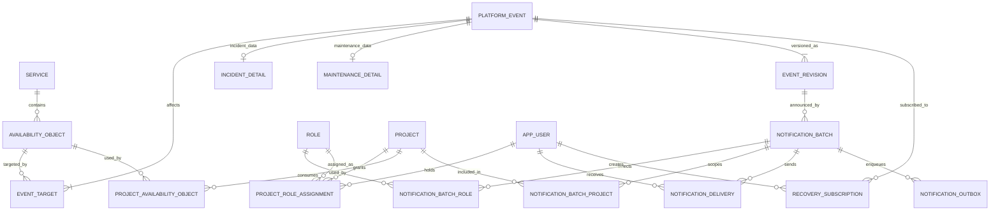

# N1 Hub: модель данных для бэка

**Версия:** 0.1 от 28 октября 2026 года. **Статус:** предложение для согласования, не утверждённый контракт API и не готовая миграция.

Основание: [предметная модель](DOMAIN_MODEL.md). Обозначения Q1–Q8 ссылаются на вопросы в ней. [schema-draft.sql](schema-draft.sql) — конкретный вариант DDL для обсуждения на PostgreSQL. Он не применялся к базе и не подключён к прототипу.

## 1. Принципы

1. Каталог задаёт допустимые объекты доступности. Создание события выбирает их ID, а не произвольные строки региона, ландшафта и кластера.
2. Доступность, тип события и жизненный цикл хранятся раздельно.
3. Одно событие может затрагивать несколько объектов нескольких сервисов; связь M:N явная.
4. Редактирование сохраняет ID события и увеличивает версию. Отправленное письмо относится к неизменяемой версии.
5. Телеметрия не создаёт инцидент автоматически. Для этого потребуется отдельное бизнес-правило, если команда его согласует.
6. Рассылка не выполняется в транзакции HTTP-запроса сохранения события. Постановка на отправку и доставка — разные операции.
7. Справочники из прототипа используются как материал для проверки, а не автоматически импортируются в production.

## 2. Таблицы и ключевые поля

### Каталог и размещения

| Таблица | Основные поля и ключи | Назначение |
|---|---|---|
| `service` | `id uuid PK`, `code UNIQUE`, `name`, `is_global`, `is_active` | Логический сервис. Для трёх порталов `is_global=true` — предложение, соответствующее принятому интерфейсу. |
| `region` | `id PK`, `code UNIQUE`, `name` | Регион. Не использовать название как внешний ключ. |
| `landscape` | `id PK`, `code UNIQUE`, `name` | Ландшафт. Состав справочника зависит от Q1. |
| `placement_zone` | `id PK`, `code UNIQUE`, `name` | Кандидат на отдельное измерение зон. Не заполнять ЦДМЗ/иЦДМЗ до решения Q1. |
| `cluster` | `id PK`, `catalog_key UNIQUE`, `name`, FK на регион, ландшафт, зону | Инфраструктурный кластер. Имя не уникально: одинаковая подпись не доказывает тождество ресурса. Глобальный каталог — предложение из Q3. |
| `service_component` | `id PK`, `service_id FK`, `code`, `name`; `UNIQUE(service_id, code)` | Jenkins / PT-AI / SAST и другие компоненты. |
| `availability_object` | `id PK`, `service_id FK`, `object_key`, `label`, `landscape_id FK`, необязательные FK на регион, зону, кластер, компонент | Единица мониторинга и воздействия события. `UNIQUE(service_id, object_key)`. |

`object_key` — стабильный ключ размещения в каталоге, не текст статуса и не вычисление из отображаемого названия. Например, `prod` у портала и отдельный ключ размещения для кластера контейнеризации. При переименовании ID и ключ не меняются.

У `availability_object` компонент может принадлежать только тому же сервису: это закреплено составным FK. Совпадение региона/ландшафта размещения с метаданными кластера проверяется сервисом каталога в транзакции. Если команда подтвердит общие физические кластеры, это правило можно дополнительно закрепить составными FK/триггером.

**Глобальные порталы:** один объект Prod без региона, кластера и компонента. Поле ландшафта в форме скрыто; сервер определяет Prod по каталогу. UI не должен иметь права назначить такому объекту Dev только потому, что это значение существует в общем справочнике.

**Архивирование:** сервисы и объекты с историей не удаляются физически. Новые события не должны ссылаться на архивные объекты, но исторические ссылки сохраняются.

### События и история

| Таблица | Основные поля и ключи | Назначение |
|---|---|---|
| `platform_event` | `id PK`, `public_number UNIQUE`, `kind`, `lifecycle_status`, `title`, фактическое начало/окончание, авторы, временные метки, `version` | Общая запись события. Номер может не показываться в карточке, но нужен для ссылок и интеграций. |
| `incident_detail` | `event_id PK/FK`, `severity`, `declared_impact`, `recovery_duration_seconds`, `problem_description`, `cause` | Только инцидент. `cause` может быть неизвестной. |
| `maintenance_detail` | `event_id PK/FK`, `planned_started_at`, `planned_ended_at`, `work_description` | Только плановая работа. План и факт не перезаписывают друг друга. |
| `event_target` | составной PK `(event_id, availability_object_id)` | Явная M:N-связь. Один объект указывается в событии один раз. |
| `event_revision` | составной PK `(event_id, version)`, `snapshot jsonb`, автор/время | Полный снимок версии, включая область воздействия и тексты. Не заменяет нормализованные текущие таблицы. |

Не следует хранить `service_id` непосредственно в `platform_event`: он не отражает несколько сервисов. Список сервисов выводится из `event_target → availability_object → service`.

Ровно один набор деталей нужного типа и наличие хотя бы одной цели — межтабличные инварианты. Черновой SQL сам по себе их полностью не обеспечивает. Их нужно проверять в общей транзакции сохранения, либо после утверждения модели добавить отложенные constraint-триггеры.

`declared_impact` не является результатом мониторинга. Текущая форма инцидента поддерживает «Недоступен»; дополнительные значения в SQL — предложение для развития модели, не требование добавить их в UI. В частности, телеметрическое `degraded` не превращается в карточку без создания события.

### Мониторинг и вычисленная доступность

| Таблица | Основные поля и ключи | Назначение |
|---|---|---|
| `telemetry_source` | `id PK`, `code UNIQUE`, `name` | Источник наблюдений. |
| `telemetry_observation` | `id PK`, FK на источник и объект, `source_message_id`, `state`, `observed_at`, `received_at` | Наблюдение. `UNIQUE(source_id, source_message_id)` защищает от повторного приёма одного сообщения. Контракт источника должен гарантировать уникальность message ID на сообщение/объект. |
| `availability_snapshot` | `availability_object_id PK/FK`, `state`, `calculated_at`, `rule_version`, ссылка на наблюдение, `basis jsonb` | Пересчитываемая текущая проекция. Не первичный источник истории. |

Предлагаемые значения доступности: `available`, `degraded`, `unavailable`, `unknown`. Последнее требует решения команды: при отсутствии/устаревании телеметрии нельзя без правила подразумевать `available`.

`basis` хранит объяснение расчёта: использованные версии событий, источники и причины. Это производные данные, которые можно пересобрать; ссылки внутри JSON не заменяют нормализованные `event_target`.

**Q5 блокирует реализацию расчёта:** нужно утвердить приоритеты источников, обработку пересечений, допустимый возраст наблюдения, влияние будущих работ и агрегацию по сервису. В DDL намеренно нет функции, повторяющей текущий `find()` из прототипа.

Для календаря нужна история наблюдений/интервалов. Зелёная ячейка «событий нет» и подтверждённый uptime — разные показатели. Метрику календаря нужно назвать до реализации SLA-расчётов.

### Аудитория, рассылка и подписки

| Таблица | Основные поля и ключи | Назначение |
|---|---|---|
| `app_user` | `id PK`, `identity_provider`, `external_subject`, отображаемое имя, адрес, активность | Локальная ссылка/проекция пользователя внешней системы идентификации; не отдельная система паролей. |
| `project` | `id PK`, `source_system`, `external_id`, `name` | Локальная ссылка на проект. Источник требуется согласовать. |
| `role` | `code PK`, `name`, активность | Согласованный список ролей. Код не зависит от локализации названия. |
| `project_role_assignment` | составной PK `(project_id, user_id, role_code)` | Кто имеет роль в конкретном проекте. Не путать с правом редактирования страницы доступности. |
| `project_availability_object` | составной PK `(project_id, availability_object_id)` | Предлагаемая связь потребления сервиса проектом. Источник и смысл связи — Q7. |
| `notification_default_role` | `role_code PK/FK` | Три роли формы по умолчанию. Предвыбор не даёт сам по себе права отправки. |
| `notification_batch` | `id PK`, FK на `(event_id, event_version)`, тема/текст, состояние, версия политики аудитории, автор, ключ идемпотентности | Отдельная рассылка по сохранённой версии события. |
| `notification_batch_role` | составной PK `(batch_id, role_code)` | Выбранные роли. В SQL FK называется `notification_batch_id`. |
| `notification_batch_project` | составной PK `(batch_id, project_id)` | Зафиксированная проектная область рассылки после определения аудитории. |
| `notification_delivery` | `id PK`, `batch_id FK`, `user_id FK`, канал, зафиксированный адрес, статус, попытки, ID провайдера | Конкретная доставка. Уникальность `(batch_id, user_id, channel)` убирает повторы одному человеку из-за нескольких ролей/проектов. |
| `notification_outbox` | `id PK`, `batch_id FK`, `deduplication_key UNIQUE`, время доступности, попытки, блокировка, обработка | Надёжная постановка задания для фонового отправителя. |
| `recovery_subscription` | составной PK `(user_id, event_id)` | Вариант MVP: подписка на завершение конкретного события. Подписки на размещение/сервис потребуют отдельного правила. |

**Предложенная формула адресатов (Q7):**

`цели события → связанные проекты → пользователи с выбранными ролями в этих проектах → исключение недоступных адресатов → дедупликация → зафиксированные доставки`.

Пока источник проектных связей не определён, нельзя заменять эту формулу рассылкой всем пользователям с нужной ролью. Команда может выбрать другую политику; её версию нужно сохранять в рассылке.

Адрес фиксируется в доставке на момент постановки, чтобы изменение профиля не меняло задним числом аудиторию уже отправленного письма. Срок хранения адресов, журналов доставки и основание уведомлений нужно согласовать с владельцем данных. Это не означает, что все адреса должны быть доступны в обычном API карточки события.

## 3. ER-диаграмма ядра и рассылки

Диаграмма — логический обзор основных таблиц; полный перечень FK находится в SQL. Каталог измерений и телеметрия описаны выше и не дублируются здесь ради читаемости.



Обязательность «хотя бы одна цель/версия» относится к сохранённому опубликованному событию. Внутри транзакции создания промежуточное состояние может не удовлетворять диаграмме.

## 4. Жизненный цикл: предложение, требующее утверждения

| Тип | Предлагаемые состояния | Значение |
|---|---|---|
| Инцидент | `draft → active → completed`; возможна `cancelled` | Подготовка, действующий инцидент, завершение, отмена ошибочной записи. |
| Плановая работа | `draft → scheduled → active → completed`; возможна `cancelled` | Отдельные стадии планирования и фактического выполнения. |

Разрешённые переходы, возможность переоткрытия и отмены — Q8. SQL содержит значения, но не реализует автомат состояний и авторизацию переходов.

Соответствие текущему UI:

- Инцидент со значением «Недоступен» → `kind=incident`, `lifecycle_status=active`, `declared_impact=unavailable`.
- Инцидент со значением «Завершено» → `kind=incident`, `lifecycle_status=completed`, фактическое окончание обязательно.
- Новые плановые работы → `kind=maintenance`, `lifecycle_status=scheduled`, обязательный плановый период. Текущей форме не хватает отдельного управления фактическим началом/завершением работ: это зазор между UI и предлагаемой моделью.
- «Перебои» из мониторинга → `telemetry_observation.state=degraded`; записи `platform_event` не требуется.
- Метка «Плановые работы» в таблице → представление связи с работами, а не отдельное значение `availability_state`.

## 5. Контракты операций: эскиз для обсуждения

Названия маршрутов ниже — предложение. Общая модель важнее конкретного URL.

| Операция | Результат и проверки |
|---|---|
| `GET /catalog/availability-objects?serviceId=…` | Существующие размещения и метаданные; не все комбинации справочников. Можно возвращать допустимые значения для зависимых списков. |
| `GET /availability` | Проекция доступности, текущие и будущие события отдельно, время расчёта, качество данных. |
| `GET /events/{id}` | Событие, типовые детали, точные target IDs, версия; ссылки на справочник для отображения тегов. |
| `POST /events` | Событие + детали + targets + revision в одной транзакции. Автор определяется сервером. Ключ идемпотентности создания — в контракте API/хранилище запросов, не `Date.now()`. |
| `PATCH /events/{id}` | Проверка ожидаемой версии, замена деталей/целей, увеличение версии, новая revision; при конфликте возврат ошибки, а не молчаливая перезапись. |
| `POST /events/{id}/notification-drafts` | Черновик рассылки по конкретной версии; выбранные роли и согласованная область проектов; сервер формирует текст. |
| `GET /notification-batches/{id}/preview` | Тема, текст, роли, область и при доступности расчёта число адресатов. Не требуется показывать персональные адреса всем авторам. |
| `POST /notification-batches/{id}/send` | Проверка прав, версии и аудитории; фиксация доставок и outbox, перевод в `queued`, идемпотентность повторного клика. Не ответ «все письма доставлены». |
| `GET /notification-batches/{id}` | Текущее состояние рассылки и счётчики доставок/ошибок. |
| `PUT /events/{id}/recovery-subscription` | Идемпотентное создание подписки текущего пользователя. Отмена — отдельный `DELETE`. |

### Пример тела создания инцидента

IDs ниже иллюстративные. Их должен выдавать подтверждённый каталог; они не соответствуют индексам массивов прототипа.

```json
{
  "kind": "incident",
  "lifecycleStatus": "active",
  "title": "Не создаются новые пространства",
  "availabilityObjectIds": [
    "11111111-1111-4111-8111-111111111111",
    "22222222-2222-4222-8222-222222222222"
  ],
  "actualStartedAt": "2026-10-28T15:00:00+03:00",
  "actualEndedAt": null,
  "incident": {
    "severity": "high",
    "declaredImpact": "unavailable",
    "recoveryDurationSeconds": 14400,
    "problemDescription": "Новые пространства не создаются.",
    "cause": null
  }
}
```

UI может собрать эту операцию и последующее создание черновика рассылки в один пользовательский сценарий «Сохранить». Но ошибка подготовки рассылки не должна притворяться ошибкой сохранения уже созданного события. В ответе нужно явно различать оба результата и допускать безопасный повтор второго шага.

Текущие поля прототипа `region`, `env`, `cluster`, `services` в виде строк/массивов отображения не предлагаются как первичные поля API. Это производные значения из ID целей.

## 6. Транзакции и неизменяемость

### Сохранить / отредактировать событие

1. Проверить право пользователя и допустимость перехода состояния.
2. Проверить ожидаемую `version` при обновлении; заблокировать запись или использовать `UPDATE … WHERE version = expectedVersion`.
3. Проверить существование, активность и доступность автору каждого объекта каталога.
4. Проверить типовые детали и временные ограничения.
5. Записать событие, детали и уникальные цели.
6. Записать полную revision с новой версией. Все шаги — одна транзакция.
7. Запланировать пересчёт доступности. Не выполнять отправку писем из сохранения события.

### Подтвердить отправку

1. Загрузить черновик по ID, проверить его состояние и права автора.
2. Проверить неизменность показанной пользователю версии письма/аудитории. При изменении — вернуть на новый предпросмотр.
3. Определить и зафиксировать адресатов по согласованной политике; несколько ролей/проектов не создают дубликаты одному пользователю.
4. В одной транзакции зафиксировать текст, аудиторию, `queued_at`, ключ идемпотентности, доставки и запись outbox.
5. Отправлять фоновым обработчиком. При повторе запроса с тем же ключом возвращать прежнюю операцию.

Уникальные ключи и outbox сами по себе **не гарантируют exactly-once доставку внешнего письма**. При сбое между приёмом письма провайдером и записью результата нужен поддерживаемый провайдером ключ идемпотентности либо процедура сверки. `accepted` означает принятие провайдером; `delivered` — подтверждение доставки, если провайдер его предоставляет.

После постановки в очередь текст/версия/аудитория batch неизменяемы. Правка события создаёт новую revision и, при необходимости, новую рассылку. Возврат из предпросмотра к форме не отменяет уже сохранённое событие; он открывает его для следующей правки.

## 7. Что обеспечивает SQL и что ещё должен обеспечить бэк

| Правило | Где обеспечивается в черновике |
|---|---|
| Существование ссылок, уникальность связей события и объекта | FK и составные PK |
| Принадлежность компонента тому же сервису | Составной FK |
| Уникальный публичный номер и версия снимка | UNIQUE / PK |
| Окончание позже начала, положительная длительность восстановления | CHECK |
| Запрет `scheduled` у инцидента; обязательные фактические даты для завершения | CHECK, часть временной модели |
| Ровно правильный тип detail и непустая область события | Транзакционная проверка API; SQL этого полностью не обеспечивает |
| Глобальный сервис только в Prod без региона/кластера/компонента | Правило каталога/API; межтабличная проверка |
| Реальная идентичность общих кластеров и полнота каталога | Решение команды и источник каталога |
| Разрешённые переходы жизненного цикла | Автомат состояний в сервисе; SQL enum недостаточно |
| Права на редактирование/рассылку | Серверная авторизация; `role` получателя не является административным правом |
| Правильный расчёт доступности | Утверждённые Q5/Q6 и версионируемый расчёт |
| Неизменяемость revisions и queued batches | Сервисные операции + права БД/триггеры после согласования |
| Согласованность revision с текущими деталями/целями | Одна транзакция сохранения |
| Непустые роли и определённая аудитория перед отправкой | Проверка отправки; блокировка при неизвестной политике |
| Отсутствие дублей из-за нескольких ролей | UNIQUE доставки по пользователю/каналу; правила общих адресов требуют отдельного решения |
| Хранение и сроки удаления истории/адресов | Политика данных; в черновике не заданы |

## 8. Сопоставление с текущим кодом

| Прототип | Предлагаемая модель | Особенность переноса |
|---|---|---|
| `services[]` и `mode` | `service` + объекты каталога | UI-режим отображения не должен заменять топологию. |
| `unitsFor(service)` | `availability_object` | Вычисляемые подписи заменить устойчивыми IDs подтверждённых объектов. |
| `event.targets[]` | `event_target` | Сейчас tuple `{service, region, env, cluster}`; в бэке FK на объект. |
| `service` / `services` на событии | Производный список сервисов | Старое `service` — совместимость с единственным сервисом, не источник истины. |
| `status` | `kind` + `lifecycle_status` + доступность/воздействие | Автоматически переносить строку в один enum нельзя. |
| `recoveryDuration: "4 часа"` | `recovery_duration_seconds: 14400` | Разобрать ввод, подтвердить точность и допустимые единицы. |
| `start` / `end` без TZ | Фактические и плановые поля `timestamptz` | Явно трактовать старые строки как МСК, не как UTC или timezone сервера. |
| `mailRequested` | Намерение создать `notification_batch` | Не доказательство отправки. |
| `recipientRoles[]` с названиями | `notification_batch_role.role_code` | Стабильные коды, пользовательские названия отдельно. |
| `mailStatus: queued-demo` | Нет production-соответствия | Прототип не отправлял письма. Такие записи нельзя импортировать как `queued`/`sent`. |
| Локальная кнопка подписки | `recovery_subscription` | Нужна идентичность пользователя и согласованный момент восстановления. |
| `localStorage` и правки поверх демособытий | Транзакции + версии | Демоданные не считаются подтверждённой миграцией. |

## 9. Предлагаемый порядок реализации

1. **Каталог и определения:** закрыть Q1–Q3, получить таблицу размещений от владельцев сервисов. Сначала проверить примеры порталов, контейнеризации, ClickHouse и Jenkins.
2. **События:** согласовать Q4/Q8; реализовать создание/правку, targets, версии, проверки и серверные права.
3. **Доступность:** согласовать Q5/Q6; подключить источники телеметрии и расчёт проекции, затем календарь с определённой метрикой.
4. **Уведомления:** закрыть Q7; подключить источник ролей/проектов, адресатов, предпросмотр, outbox и провайдера доставки.
5. **Подписки и эксплуатация:** правила восстановления, повторы/ошибки, срок хранения истории, наблюдаемость отправителя.

Можно разрабатывать этапы независимо по согласованным контрактам, но нельзя считать открытые вопросы решёнными лишь потому, что для них уже создано поле в SQL.

## 10. Проверки перед принятием схемы

- Один портальный сервис: только Prod, без региона и кластера.
- Два сервиса одного кластера: определить, одна ли это инфраструктура и нужны ли две явные цели события.
- Несколько выбранных ландшафтов/кластеров: только существующие размещения, без декартова произведения.
- Повторное сохранение с устаревшей версией: конфликт, история не затирается.
- Перекрывающиеся события: ни одно не теряется из-за порядка выборки.
- Будущая работа: предупредительная метка не выдаётся за уже произошедший простой без согласованного правила.
- Повторное сообщение телеметрии: не создаёт дубликат наблюдения.
- Повторный клик «Отправить»: та же операция; после перезапуска обработчика нет неконтролируемого повторения.
- Один человек с несколькими ролями/проектами: одна доставка данного письма на канал, согласно политике.
- Правка события после отправки: текст и аудитория старого письма остаются прежними.
- Часовой пояс сервера отличается от МСК: введённые даты сохраняют исходный момент времени.

### Статус проверки артефактов

Документы сверены с исходниками прототипа. SQL подготовлен как DDL-черновик без запуска на PostgreSQL. Перед превращением в миграцию нужны утверждение бизнес-правил, выбор поддерживаемой версии PostgreSQL, применение на пустой тестовой БД и интеграционные проверки ограничений и транзакций. Успешная сборка фронтенда не считается проверкой этой схемы.
