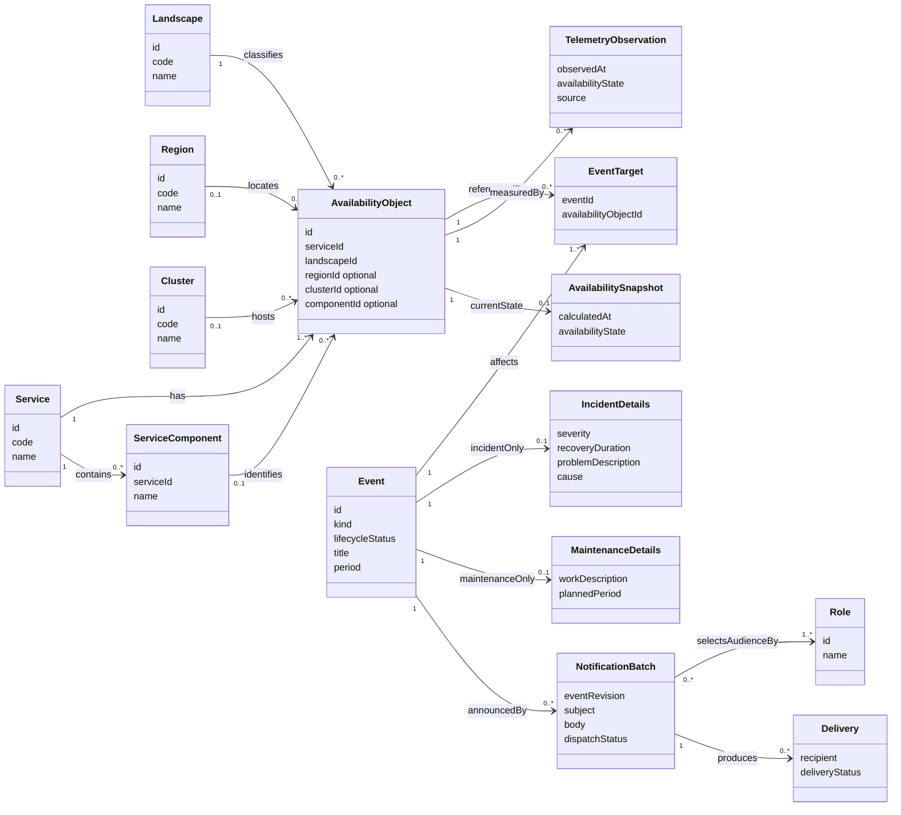

# N1 Hub: предметная модель доступности и событий

**Версия:** 0.1 от 28 октября 2026 года. **Статус:** рабочий черновик для согласования командой.

Документ собран по текущему прототипу и принятым в ходе его разработки решениям. Его задача — дать команде общую схему, на которой можно подтвердить данные, исправить допущения и определить правила для реализации. Прототип не является подтверждённым реестром инфраструктуры.

Сопутствующие материалы: [модель для бэка](BACKEND_DATA_MODEL.md), [черновой SQL](schema-draft.sql).

## 1. Что нужно согласовать в первую очередь

| № | Решение | Почему оно влияет на продукт |
|---|---|---|
| Q1 | Что именно называется регионом, ландшафтом и зоной? | Сейчас рядом стоят география, стадия жизненного цикла и, возможно, сетевые зоны. От этого зависят фильтры и допустимые комбинации. |
| Q2 | Подтверждённый состав размещений каждого сервиса | Список ниже перенесён из демоданных. Особенно нужны проверки общих кластеров, регионов простых сервисов и компонентов Jenkins / PT-AI / SAST. |
| Q3 | Один кластер — общий ресурс для нескольких сервисов или отдельный объект внутри сервиса? | Одинаковые имена кластеров повторяются у нескольких сервисов. Нельзя автоматически считать их одним физическим ресурсом. |
| Q4 | Может ли одно событие затрагивать несколько сервисов? А несколько объектов с разным воздействием? | Множественный выбор уже есть в интерфейсе, но правила такого события ещё нужно подтвердить. |
| Q5 | Как рассчитывается доступность при пересечении инцидентов, работ и телеметрии? | Сейчас порядок выбора данных в коде влияет на результат. Это не согласованное правило приоритета. |
| Q6 | Когда плановая работа считается ограничением: с публикации или с начала работ? | В прототипе учитываются и будущие работы. Нужно отличить предупреждение о будущем ограничении от текущей недоступности. |
| Q7 | Как определяются адресаты по роли: по затронутым проектам, всем проектам платформы или иной аудитории? | Выбор названия роли сам по себе не даёт списка пользователей. |
| Q8 | Какие состояния и переходы есть у инцидента и плановой работы? | «Недоступен», «Плановые работы» и «Завершено» описывают разные понятия, их нельзя безоговорочно хранить одним статусом. |

**Предлагаемый результат обсуждения:** подтверждённая матрица «сервис → объекты доступности», определения трёх измерений из Q1, правила статусов, аудитории и жизненного цикла событий. Для каждого решения стоит назначить владельца и записать дату подтверждения.

## 2. Как читать документ

- **[Р] Решение прототипа** — явно принято при проработке интерфейса; команде нужно подтвердить применимость для продукта.
- **[Д] Демоданные** — содержимое текущего кода, которое нельзя считать фактом об инфраструктуре.
- **[П] Предложение** — модель для обсуждения, ещё не утверждённое требование.
- **[В] Вопрос** — данных или бизнес-правила пока нет.

Имена сущностей на английском даны для однозначного обсуждения с разработчиками. Они не фиксируют названия API или таблиц.

## 3. Основная идея модели

**Сервис** — логическая возможность платформы, например «Контейнеризация». **Объект доступности** — конкретная единица этого сервиса, чьё состояние показываем пользователю: сервис в Prod, кластер сервиса, компонент или размещение в одном ландшафте.

Предлагаемая цепочка:

`Сервис → Объект доступности ← Область воздействия события → Событие`

Объект доступности имеет устойчивый ID. Регион, ландшафт, кластер и компонент — его характеристики или ссылки на справочники. Событие ссылается на существующие объекты, а не создаёт все сочетания выбранных строк.

**Пример.** Выбор «Контейнеризация», Prod и PreProd, двух кластеров не означает четыре комбинации. Допустимы только размещения, действительно существующие в каталоге: например, Prod-DH-Ekb в Prod и PreProd-DH-SPb в PreProd.

**«Окружения» в карточке — название представления**, объединяющего теги региона, ландшафта и кластера/компонента. Это не дополнительная сущность и не синоним одного ландшафта.

## 4. Концептуальная UML-диаграмма

Диаграмма описывает **предлагаемую целевую модель [П]**, а не существующую базу данных. Множественности показывают количество объектов на концах связи. `0..1` означает необязательную связь. Диаграмма записана в Mermaid: её можно редактировать вместе с документом в Markdown-редакторе с поддержкой Mermaid.

Ограничения, не выраженные стрелками:

1. У события ровно один тип: инцидент **или** плановая работа. Детали второго типа отсутствуют.
2. Событие затрагивает не менее одного объекта доступности; повтор одной пары «событие — объект» запрещён.
3. Один объект может быть связан с несколькими событиями одновременно; правило расчёта итоговой доступности нужно согласовать отдельно.
4. Кластер и компонент необязательны и не взаимозаменяемы. Возможность их совместного использования — Q2/Q3.
5. Один общий кластер у разных сервисов на диаграмме — предложение из Q3, не установленный факт.
6. Рассылка привязана к конкретной версии события. Последующее редактирование карточки не меняет уже подготовленное или отправленное письмо.
7. Роли задают условие выбора адресатов. Конкретных людей определяют назначения ролей и согласованная область проектов; эта часть раскрыта в модели бэка.

## 5. Сущности и их смысл

| Сущность | Назначение и основные данные | Что известно |
|---|---|---|
| Сервис / `Service` | ID, стабильный код, название, состав объектов доступности | [Р] Одна строка таблицы соответствует логическому сервису. [Д] В прототипе 17 сервисов. |
| Объект доступности / `AvailabilityObject` | ID, сервис, ландшафт; необязательные регион, кластер, компонент | [П] Центральная сущность, позволяющая связать каталог, мониторинг, события и уведомления. Сейчас представлена вычисляемыми `unitsFor()` и объектами `targets`. |
| Ландшафт / `Landscape` | Справочник стадий/вариантов размещения | [Р] В фильтре Dev, UAT, PreProd, Prod, ЦДМЗ, иЦДМЗ. [В] Последние два значения могут быть другой осью классификации. |
| Регион / `Region` | Справочник региональной привязки | [Р] Центральный без разделения СПб/Екб. [Д] Также есть «Среда разработки»; смысл этого значения нужно проверить. |
| Кластер / `Cluster` | Идентификатор и название инфраструктурного объекта | [Д] Имена содержат ландшафт, площадку и технологию, но связи следует хранить явно, а не извлекать из имени. |
| Компонент сервиса / `ServiceComponent` | Именованная часть сервиса | [Д] Jenkins, PT-AI, SAST. Не следует хранить их как кластеры только потому, что сейчас они попадают в то же поле формы. |
| Событие / `Event` | ID, тип, заголовок, жизненный цикл, временные поля, автор и версия | [Р] Инцидент или плановая работа; создание и редактирование. [П] ID остаётся прежним при правке. |
| Область воздействия / `EventTarget` | Связь события с конкретным объектом доступности | [Р] Множественный выбор. [В] Одинаковое ли воздействие на все выбранные объекты? |
| Наблюдение телеметрии / `TelemetryObservation` | Объект, состояние, момент наблюдения, источник | [Р] «Перебои» могут прийти из телеметрии и сами по себе не создают карточку события. |
| Снимок доступности / `AvailabilitySnapshot` | Рассчитанное текущее состояние и его основания | [П] Результат сопоставления телеметрии и событий. Это не статус жизненного цикла события. |
| Рассылка / `NotificationBatch` | Версия события, роли, тема, текст, состояние отправки | [Р] После сохранения — предпросмотр, возврат к редактированию, отправка. [Д] Реальной доставки нет. |
| Доставка / `Delivery` | Конкретный адресат и результат доставки письма | [П] Необходима для подтверждения отправки и повторов; в прототипе отсутствует. |
| Подписка на восстановление / `RecoverySubscription` | Пользователь и событие либо объект, о восстановлении которого он хочет знать | [Р] Кнопка существует. [Д] Сейчас это локальное состояние кнопки. [В] Требуется определить точную область подписки. |
| Проект, пользователь, роль и назначение роли | Кто имеет какую роль в каком проекте | [П] Нужны для определения получателей. Источник и связь проектов с сервисами пока неизвестны. |

## 6. Каталог сервисов из прототипа

В таблице описано **текущее наполнение кода [Д]**, а не подтверждённая инфраструктура. Номера — индексы текущего массива; они не предлагаются как постоянные бизнес-ID.

| № | Сервис | Как показана доступность | Ландшафты / объекты | Регион в демоданных |
|---|---|---|---|---|
| 0 | Портал N1 Hub | Сервис целиком | Только Prod; регион и кластер не задаются [Р] | Нет |
| 1 | Релиз-борд | Сервис целиком | Только Prod; регион и кластер не задаются [Р] | Нет |
| 2 | Реестр СПО | Сервис целиком | Только Prod; регион и кластер не задаются [Р] | Нет |
| 3 | Контейнеризация | По кластерам | Набор K без PreProd-DH-Ekb: 11 объектов | Центральный |
| 4 | Управление API | По кластерам | Набор K: 12 объектов | Центральный |
| 5 | Управляемый сервис для Kafka | По кластерам | Набор K: 12 объектов | Центральный |
| 6 | Управление исходным кодом | Сервис целиком | Prod | Центральный, требует подтверждения |
| 7 | Управление артефактами и зависимостями | Сервис целиком | Prod | Центральный, требует подтверждения |
| 8 | Управление автоматизированной сборкой и развёртыванием | По компонентам | Jenkins, PT-AI, SAST; всем назначен Dev | Среда разработки, требует подтверждения |
| 9 | Управление релизным циклом | Сервис целиком | Prod | Центральный, требует подтверждения |
| 10 | Сервис наблюдаемости | Сервис целиком | Prod | Центральный, требует подтверждения |
| 11 | Тестирование (ТестОпс) | Сервис целиком | Prod | Центральный, требует подтверждения |
| 12 | SSO | По кластерам | Набор K: 12 объектов | Центральный |
| 13 | Продуктовая аналитика | Сервис целиком | Prod | Центральный, требует подтверждения |
| 14 | Управление задачами и проектной документацией | Сервис целиком | Prod | Центральный, требует подтверждения |
| 15 | Управляемый сервис для ClickHouse | По ландшафтам, без кластеров | Dev, UAT, PreProd, Prod | Dev → Среда разработки; остальные → Центральный |
| 16 | Управляемый сервис для Greenplum | По ландшафтам, без кластеров | Dev, UAT, PreProd, Prod | Dev → Среда разработки; остальные → Центральный |

### Набор кластеров K

| Ландшафт | Кластеры |
|---|---|
| Prod | Prod-DH-SPb, Prod-OKD-SPb, Prod-OCP-SPb, Prod-DH-Ekb, Prod-OCP-CMZ-SPb |
| PreProd | PreProd-DH-SPb, PreProd-OCP-SPb, PreProd-OCP-CMZ-SPb, PreProd-DH-Ekb |
| UAT | UAT-DH-SPb, UAT-OKD-SPb, UAT-DH-Ekb |

Важные оговорки к каталогу:

- Отсутствие PreProd-DH-Ekb у контейнеризации — принятое ограничение прототипа; его нельзя автоматически добавлять по общему списку.
- ЦДМЗ и иЦДМЗ есть в фильтрах, но соответствующих объектов в каталоге размещений сейчас нет. Наличие опции в фильтре не подтверждает существование размещения.
- Названия СПб/Екб остались в именах кластеров, хотя выбор региона объединён. Возможно, нужна отдельная сущность «Площадка»; её состав и связи не определены.
- Совпадение имени кластера у сервисов не подтверждает общую инфраструктуру или автоматическое распространение инцидента на другие сервисы.
- История генерируется демонстрационно; у некоторых простых сервисов там встречаются искусственные кластерные имена. Историю нельзя использовать для восстановления каталога.

## 7. Статусы: три отдельных понятия

| Понятие | Пример | Чего не должно означать |
|---|---|---|
| Доступность объекта | Доступен, Перебои, Недоступен; возможно «Нет данных» | Тип события и стадия его обработки |
| Тип события | Инцидент / Плановая работа | Фактическое состояние сервиса |
| Жизненный цикл события | Запланировано, активно, завершено, отменено — варианты для согласования | «Доступен / недоступен» |

**[Р] Перебои** — статус телеметрии, не автоматическое создание инцидента. Если команда создаёт инцидент вручную по телеметрии, он должен быть самостоятельной записью со ссылками на объекты.

**[Р] Плановые работы** отображаются голубым тегом с календарём и включены в ограничения. **[В]** Нужно определить временную семантику: будущая работа может быть предупреждением без текущей деградации. Не следует выводить текущую недоступность только из факта публикации работ.

**[Д]** В коде сейчас есть единый массив статусов, поиск первого незавершённого события и приоритет телеметрии над событиями. Эти технические упрощения не следует переносить в бэк как бизнес-правила. Отсутствие зарегистрированных событий в календаре также не доказывает фактическую доступность.

**[П]** Для объекта хранить наблюдения и отдельно рассчитывать представление: текущая доступность, действующие инциденты, текущие работы, предстоящие работы, момент обновления, источник/качество данных. Команде нужно утвердить таблицу приоритетов и правила агрегации нескольких объектов в состояние одного сервиса.

## 8. Состав событий

| Поле | Инцидент | Плановая работа |
|---|---|---|
| Название | Обязательно | Обязательно |
| Объекты воздействия | Один или несколько существующих объектов | Один или несколько существующих объектов |
| Состояние в текущей форме | Недоступен / Завершено; это смешение двух понятий, см. раздел 7 | Автоматическая метка «Плановые работы» |
| Критичность | Низкая, Средняя, Высокая, Критическая [Д] | Не задаётся |
| Плановый срок восстановления | Длительность от начала, например 4 часа [Р] | Не задаётся |
| Начало | Предзаполнено текущим временем МСК, редактируется [Р] | Предзаполнено текущим временем МСК, редактируется [Р] |
| Окончание | Необязательно для продолжающегося, обязательно для завершённого | В текущей форме обязательно |
| Основной текст | Описание проблемы | Описание работ |
| Причина | Причина инцидента; может быть неизвестна | Не задаётся |
| Рассылка | Флаг, роли, предпросмотр | Флаг, роли, предпросмотр |

**Предложения для уточнения временной модели [П]:**

- Разделить плановый период работ и фактическое начало/окончание: перенос работ не должен переписывать историю фактического простоя.
- Для инцидента решить, совпадают ли время регистрации и начало недоступности. Не подменять одно другим.
- Срок восстановления хранить длительностью с единицами измерения, а не свободным текстом. Разрешённый сейчас произвольный ввод — особенность формы.
- В интерфейсе показывать МСК; в бэке хранить однозначные моменты времени с часовым поясом. Строки демоданных без смещения — не формат контракта API.
- Разрешить ли одному событию разные периоды/критичность по объектам? В текущем интерфейсе период и критичность общие на всю запись.

## 9. Рассылки, роли и подписки

**Рассылка по событию** — действие автора: выбрать роли, сохранить событие, проверить письмо, отправить. **Подписка на восстановление** — отдельное действие пользователя. Они могут иметь разные аудитории и основания отправки.

Список ролей предоставлен пользователем:

1. Руководитель проекта.
2. Архитектор проекта.
3. Разработчик проекта.
4. Тестировщик проекта.
5. Участник проекта.
6. Релиз-инженер проекта.
7. Инженер данных.
8. Аналитик данных.
9. Специалист ИБ.
10. Sequrity QA инженер.
11. Руководитель разработки.

По умолчанию выбраны: **Руководитель проекта, Архитектор проекта, Руководитель разработки** [Р]. Написание «Sequrity QA инженер» сохранено из предоставленного списка; необходимо подтвердить, что это одна роль и что название корректно.

**Неопределённая связь [В]:** `затронутые объекты → затронутые проекты → назначения ролей → пользователи → адреса доставки`. Возможен другой источник аудитории; требуется решение владельца IAM/проектов. Не следует рассылать всем людям платформы с выбранной ролью по умолчанию.

Для обсуждения: дедупликация человека с несколькими ролями; учёт участия в нескольких проектах; согласие на уведомления; права на массовую рассылку; повторы; повторная отправка после изменения события; фиксация текста и получателей на момент отправки.

## 10. Примеры, которыми команда может проверить модель

| Сценарий | Ожидаемый результат / вопрос |
|---|---|
| Событие для Портала N1 Hub | Один объект Prod, без региона и кластера; форма их не предлагает. |
| Событие для трёх порталов | Одна запись с тремя объектами Prod. Подтвердить, допустима ли общая запись для разных сервисов. |
| Недоступен Prod-DH-Ekb контейнеризации | Затрагивается именно размещение контейнеризации, а не каждый сервис с таким именем кластера. |
| Работы на двух кластерах в разных ландшафтах | Две реальные связи, без декартова произведения фильтров. |
| Перебои Jenkins | Статус компонента меняется по телеметрии; карточка инцидента автоматически не появляется. |
| ClickHouse в UAT | Объект без кластера. Региональную привязку подтвердить по каталогу. |
| Будущая работа на доступном объекте | Уточнить: показываем доступность + предупреждение или считаем ограничение уже сейчас? |
| Два одновременно активных инцидента | Оба сохраняют связь с объектом. Итоговое состояние определяется утверждённым правилом, не порядком массива. |
| Завершён один из двух инцидентов | Сервис не становится доступным, пока остаются другие действующие основания ограничения. |
| Телеметрия перестала обновляться | Уточнить допустимый возраст данных и состояние «Нет данных»; не рисовать зелёный только из-за отсутствия инцидентов. |
| Изменено событие после рассылки | Старая рассылка сохраняет свой текст и адресатов; новая версия не меняет уже отправленное письмо. |
| Пользователь — и архитектор, и разработчик двух проектов | Уточнить правила аудитории и дедупликации, чтобы не отправить несколько одинаковых писем. |

## 11. Как собрать подтверждённую модель

Предлагается обсуждать не названия полей формы, а примеры из раздела 10 и матрицу каталога. После встречи заполнить журнал решений и обновить схему.

| Решение / вопрос | Подтверждённое правило | Владелец | Источник / ссылка | Дата |
|---|---|---|---|---|
| Q1: измерения размещения | — | — | — | — |
| Q2: состав размещений сервисов | — | — | — | — |
| Q3: общие кластеры и зависимости | — | — | — | — |
| Q4: несколько сервисов в событии | — | — | — | — |
| Q5: расчёт доступности | — | — | — | — |
| Q6: будущие работы | — | — | — | — |
| Q7: аудитория рассылки | — | — | — | — |
| Q8: жизненный цикл события | — | — | — | — |

Минимальная таблица для владельцев сервисов:

| Код сервиса | Название | ID объекта | Ландшафт | Регион или «не применимо» | Кластер / компонент или «нет» | Источник мониторинга | Владелец данных |
|---|---|---|---|---|---|---|---|
| пример: portal-hub | Портал N1 Hub | заполнить | Prod | Не применимо [Р] | Нет [Р] | заполнить | заполнить |
| пример: containers | Контейнеризация | заполнить | Prod | Центральный [Д] | Prod-DH-Ekb [Д] | заполнить | заполнить |

## 12. Основания и границы документа

Исходники относительно корня проекта:

- `src/data.js` — каталог сервисов, наборы кластеров, `unitsFor`, телеметрия и демонстрационные события.
- `src/eventModel.js` — множественная область воздействия `targets`, глобальные порталы, роли, формирование письма.
- `src/EventScopeFields.jsx` — зависимые списки формы.
- `src/EventEditor.jsx` — поля и проверки событий, значения ролей по умолчанию.
- `src/main.jsx` — таблица, календарь, карточки, фильтры и локальное сохранение.
- `src/MailPreview.jsx` — сценарий предпросмотра.

Серверного каталога, интеграции мониторинга, IAM, реальной доставки писем и подтверждённой ER-модели в проекте пока нет. Числа и правила из демоданных в этом документе специально отмечены: цель документа — превратить их в проверяемые вопросы, а не закрепить случайные решения прототипа.
